<p><picture><source media="(max-width: 600px)" srcset="assets/readme/hero-mobile.svg"/>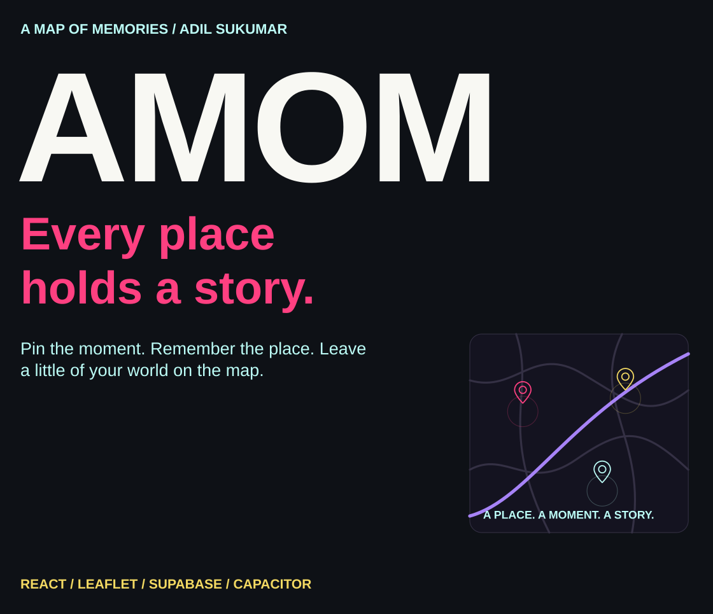</picture></p>

<p align="center"><a href="#the-idea">The idea</a> · <a href="#from-place-to-memory">Workflow</a> · <a href="#the-map-experience">Map</a> · <a href="#run-locally">Run locally</a> · <a href="#visibility-and-data-flow">Visibility</a> · <a href="#explore-the-source">Source</a></p>

<a id="the-idea"></a>

##  The idea

I built A Map Of Memories around a simple thought: places mean more than their coordinates. A café can hold a conversation you still remember. A street can take you back years. AMOM gives those moments a place on an interactive map, so people can revisit their own stories and discover the ones others choose to share.

<p><picture><source media="(max-width: 600px)" srcset="assets/readme/features-mobile.svg"/>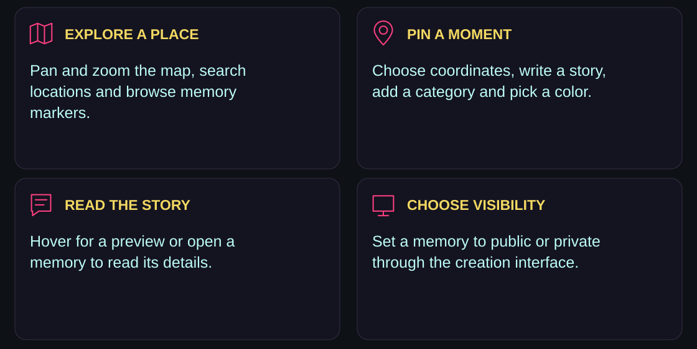</picture></p>

Explore public memories without contributing, or sign in to create your own. The creation popup starts with private visibility; sharing publicly is a choice.

<a id="from-place-to-memory"></a>

##  From place to memory

<p><picture><source media="(max-width: 600px)" srcset="assets/readme/workflow-mobile.svg"/>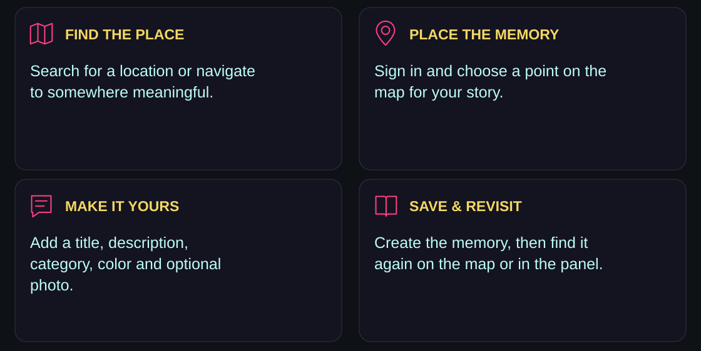</picture></p>

Memories carry a title, description, coordinates, color and visibility flag, with a category and optional photo. Categories include love, travel, food, friendship, family, adventure, memory and other. A memory can be opened from its marker or the memories panel.

<a id="the-map-experience"></a>

##  The map experience

<p><picture><source media="(max-width: 600px)" srcset="assets/readme/experience-mobile.svg"/>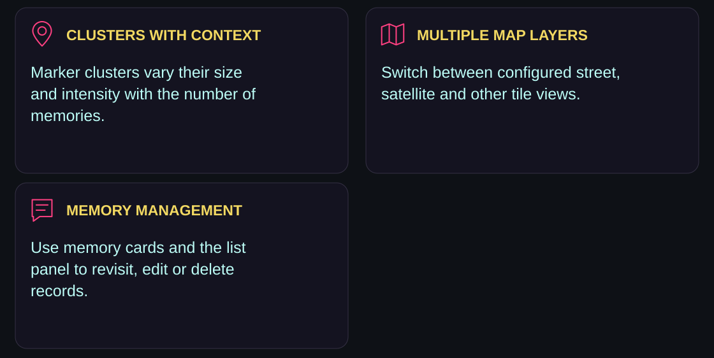</picture></p>

Leaflet powers the map and marker clustering. More densely populated clusters use different sizes and colors; individual markers reflect the memory color. Hover previews show story context, while a click opens the detail card.

Location search uses Nominatim. The component configures OpenStreetMap, Esri, CARTO and other tile layers, and supports browser geolocation when permission is granted. Availability and coverage depend on those services.

The current memory hook fetches on load and auth changes, and updates this client after successful writes. It does not subscribe to database changes from other users, so this README does not promise automatic cross-client live updates.

<a id="run-locally"></a>

##  Run locally

<p><picture><source media="(max-width: 600px)" srcset="assets/readme/environment-mobile.svg"/>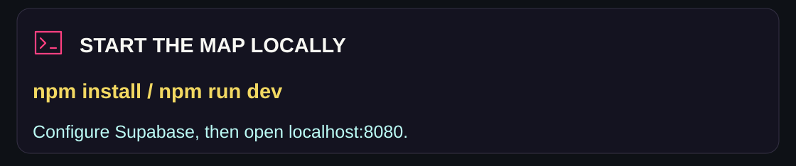</picture></p>

```bash
git clone https://github.com/adilsukumar/AMOM-A-Map-of-Memories.git
cd AMOM-A-Map-of-Memories
npm install
```

Create `.env` in the repository root, using [.env.example](.env.example):

```env
VITE_SUPABASE_URL=your_supabase_url
VITE_SUPABASE_ANON_KEY=your_supabase_anon_key
```

```bash
npm run dev
```

Open `http://localhost:8080`, or the address printed by Vite. Auth and memory operations require a compatible Supabase backend; the client’s placeholder values are not a working local database.

The source expects a `memories` table matching [Memory](src/integrations/supabase/types.ts), including ownership, title, description, coordinates, color, visibility, photo URL, category and timestamps. Some profile operations also expect profile data. This repository does not include database migrations or RLS policy SQL, so a new Supabase project needs that backend setup separately.

### Build and checks

```bash
npm run lint
npm run build
npm run preview
```

The project also declares `npm run build:dev`. These are the existing scripts; there is no dedicated web test script.

### Stack and project structure

| Role | Technology |
|---|---|
| Frontend | React 18, TypeScript, Vite |
| UI | Tailwind CSS, shadcn/ui and Radix components |
| Map | Leaflet, React Leaflet and MarkerCluster |
| Backend | Supabase client and Supabase Auth |
| Native wrappers | Capacitor with Android and iOS project folders |

```text
src/components/           map, memory, profile and UI components
src/hooks/useMemories.ts   memory queries and writes
src/contexts/             authentication state
src/integrations/         Supabase client and memory types
src/pages/                landing, map and authentication routes
android/ and ios/         Capacitor native wrapper projects
capacitor.config.ts       app identity and dist web directory
```

The native folders are included in the repository; they do not by themselves establish a published mobile-app release.

<a id="visibility-and-data-flow"></a>

##  Visibility and data flow

<p><picture><source media="(max-width: 600px)" srcset="assets/readme/privacy-mobile.svg"/>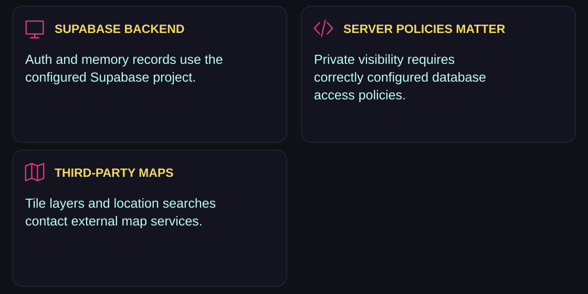</picture></p>

The client queries public memories plus the signed-in user’s own records. That filter expresses the interface’s intent; enforcement must come from the connected database’s row-level security policies. A private flag in frontend code alone is not an access-control guarantee.

Memory content, coordinates and photo data are submitted to the configured Supabase backend. Map tiles, place searches and optional browser geolocation have their own data flows. The current hook also writes memory payloads and responses to the browser console during development.

Before using a new backend, verify anonymous users can read only public records and that users can read or modify only the private records they own. Keep service-role keys out of the frontend; the configured browser key is the Supabase anonymous client key.

<a id="explore-the-source"></a>

##  Explore the source

<p align="center"><a href="src/components/MapView.tsx">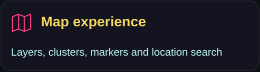</a> <a href="src/hooks/useMemories.ts">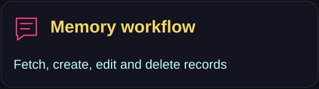</a> <a href="src/components/MapMemoryPopup.tsx">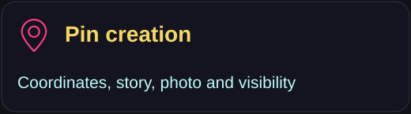</a> <a href="src/contexts/AuthContext.tsx">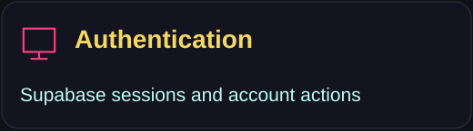</a></p>

See [MapPage](src/pages/MapPage.tsx) for the main workflow, [MemoryCard](src/components/MemoryCard.tsx) for details and edits, and [MemoriesPanel](src/components/MemoriesPanel.tsx) for the story list.

##  License and credits

This repository uses a [proprietary personal-use license](LICENSE). Read that file for the permitted uses and restrictions; contact [Adil Sukumar](mailto:adilsukumar24@gmail.com) for licensing questions. The existing license credits Mayank Mehra and Snehal Dixit for contributions.

<p><picture><source media="(max-width: 600px)" srcset="assets/readme/closing-mobile.svg"/>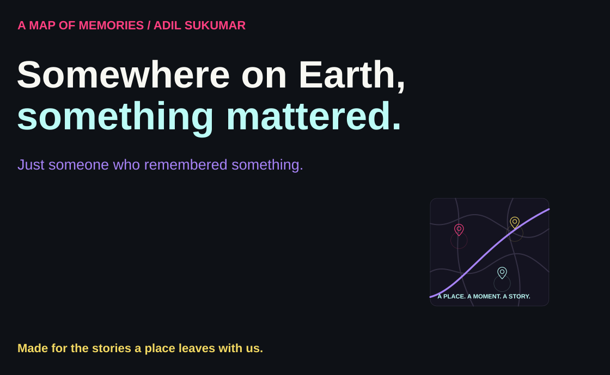</picture></p>

<p align="center"><a href="https://github.com/adilsukumar/AMOM-A-Map-of-Memories/issues">Discuss an improvement</a> · <a href="src/components/MapView.tsx">Explore the map code</a> · <a href="https://www.adilsukumar.xyz/">Meet the builder</a></p>
